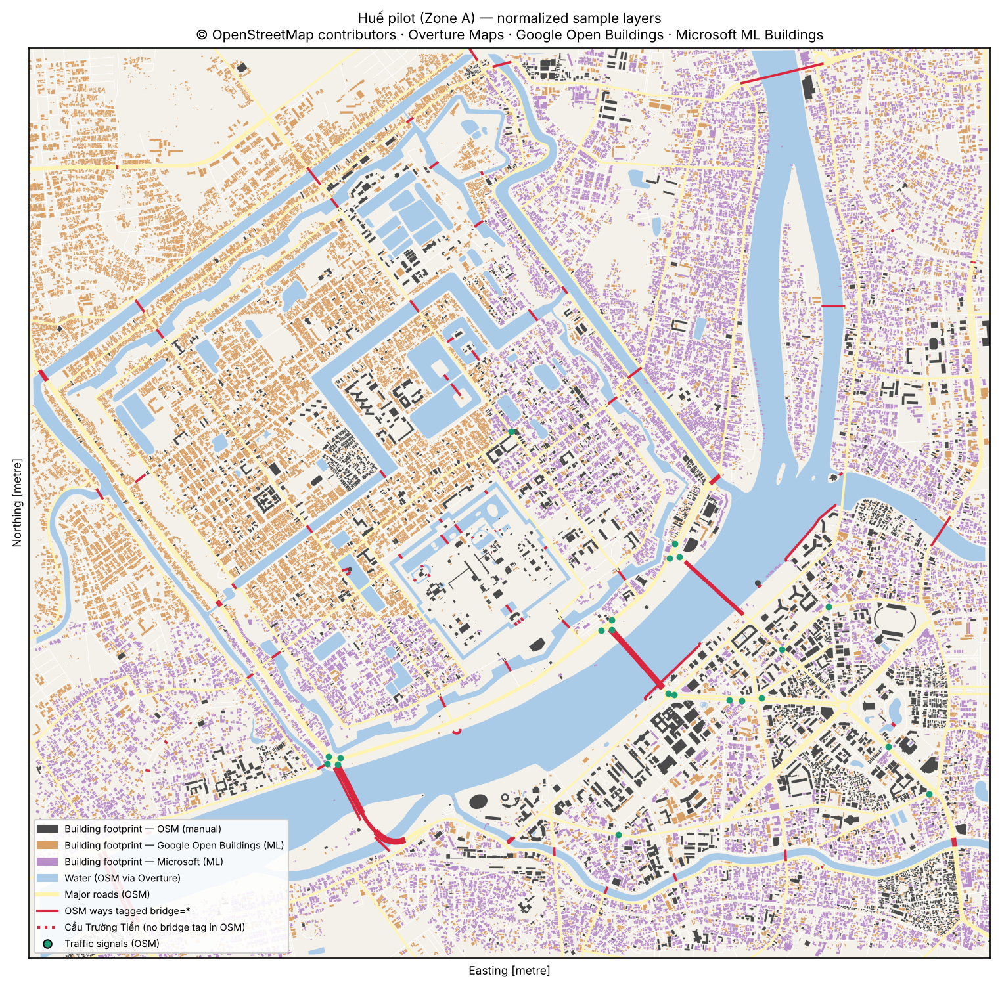

# Khảo sát nguồn dữ liệu dựng bản đồ 3D Thành phố Huế

Đợt khảo sát 2026-11-13 → 14. Thư mục này chứa danh mục nguồn đã kiểm chứng, dữ liệu mẫu thật của vùng pilot kèm nguồn gốc và checksum, script chạy lại được, và phân tích khả năng dựng 3D. **Chưa dựng mô hình 3D nào** — đây là bước khảo sát và kiểm định dữ liệu.



## Kết luận ngắn

1. **Dựng Huế 3D để xem (LoD1) làm được ngay bằng dữ liệu mở đã kiểm chứng**: mạng đường, mặt nước, dấu chân công trình và nền địa hình đều tải được, giấy phép cho phép dùng thương mại. Chiều cao nhà chỉ là ước lượng học máy (phủ 84% dấu chân pilot, lệch cỡ ±3 m theo một chỉ báo nhỏ).
2. **Chưa đủ để chỉ đường.** Trong 452 km đường xe cơ giới của pilot, 94% số đoạn chỉ "hai chiều theo mặc định"; tốc độ có ở 2% chiều dài đường chính; chỉ 13 quan hệ cấm rẽ cho 3.543 nút giao; không có biển báo nào. Không nguồn mở nào chứa quy tắc giao thông đã xác minh của Huế.
3. **Chiều thứ ba đo đạc gần như không tồn tại trong nguồn mở**: không cầu nào có cao độ hay tĩnh không; các di tích biểu tượng chỉ có dấu chân; DEM tốt nhất là mặt phủ 30 m. Dữ liệu UAV LiDAR + ảnh mà chủ dự án sẽ cung cấp là thứ lấp khoảng trống này.
4. Phát hiện cụ thể đáng nhớ: **cầu Trường Tiền không có thẻ `bridge` trong OpenStreetMap** — pipeline lọc cầu theo thẻ sẽ bỏ sót nó; phải kết hợp kiểm tra hình học (đã cài trong `scripts/06_validate_pilot.py`).

## Trả lời sáu câu hỏi nghiệm thu

### 1. Hiện có thể dựng Huế 3D đến mức nào bằng dữ liệu đã kiểm chứng?

| Lớp | Mức dựng được ngay (pilot) | Căn cứ |
|---|---|---|
| Địa hình | Nền 30 m, biên độ 0–24 m; không có taluy, kè | Copernicus GLO-30 đã tải |
| Sông Hương, hào, hồ | Đa giác đầy đủ (127 đối tượng); không có mực nước | OSM/Overture đã tải |
| Mạng đường | 452 km xe cơ giới, topology nhất quán (38 ngoại lệ trên 4.043 đoạn); bề rộng phải nội suy | OSM đã tải + kiểm tra |
| Cầu | 109 nhóm cầu có vị trí và chiều dài (lệch 1–8% so với số công bố); hình khối và cao độ phải mô hình hóa có ràng buộc | `pilot_validation.md` §2 |
| Công trình | 61.115 dấu chân (93% do học máy); khối đùn LoD1 với chiều cao ước lượng | Overture + Open Buildings 2.5D đã tải |
| Di tích | Chỉ có vị trí/dấu chân — **chưa** dựng được đúng hình | `pilot_validation.md` §6.3 |
| Cây | Mặt nạ 10 m (20% diện tích) | ESA WorldCover đã tải |

Toàn thành phố (đất liền 4.931 km²): 9.055 km đường và 759.332 dấu chân công trình có sẵn ở cùng chất lượng; ngoài pilot mới chỉ đo đường và công trình.

### 2. Phần nào mới đủ để hiển thị, chưa đủ để chỉ đường?

Tất cả thuộc tính điều khiển giao thông: chiều lưu thông, số làn và hướng rẽ theo làn, cấm rẽ, tốc độ, hạn chế theo giờ/loại xe (ví dụ trên cầu Trường Tiền và trong Kinh thành), tải trọng cầu, kích thước thông xe của cổng thành, đèn tín hiệu và camera. Trong dữ liệu mẫu các giá trị này mang trạng thái `inferred` hoặc `unknown`; phần `observed` là thẻ do cộng đồng ghi, chưa đối chiếu thực địa. Chi tiết: `coverage_matrix.csv` (cột `du_cho_chi_duong`).

### 3. Nguồn nào dùng ngay, nguồn nào cần mua hoặc xin quyền?

| Dùng ngay (đã tải, dùng thương mại được) | Cần tài khoản miễn phí | Cần xin quyền | Cần mua | Không được trích xuất |
|---|---|---|---|---|
| OpenStreetMap; Overture Maps; Copernicus GLO-30; Sentinel-2; ESA WorldCover; Google Open Buildings 2.5D; Wikidata; ảnh Wikimedia Commons (158/208 ảnh quanh các mốc có giấy phép mở) | Mapillary (để biết có ảnh phố mở tại Huế hay không); NASA Earthdata; JAXA | GISHue và nền địa hình 1:2.000; dữ liệu quét 3D của Trung tâm Bảo tồn Di tích Cố đô Huế; mô hình "Huế Smart Digital City"; danh sách đèn/camera của HueIOC; văn bản tổ chức giao thông | Ảnh vệ tinh 30 cm; DSM thương mại; dữ liệu dẫn đường (ví dụ VIETMAP) | Google Maps/Street View/3D Tiles (điều khoản cấm lưu, can vẽ, dựng 3D, nhận dạng đối tượng — đã đọc trực tiếp); ảnh nền Esri/Bing ngoài mục đích OSM |

Phân tích giấy phép: `source_catalog.md`. Danh mục 59 nguồn: `source_catalog.csv` (12 đã tải, 8 đã đọc metadata/điều khoản, 24 mới ở mức kết quả tìm kiếm).

### 4. Thiếu dữ liệu gì nghiêm trọng nhất?

- Cho chỉ đường: **quy tắc giao thông đã xác minh** (G1 trong `data_gaps.md`).
- Cho 3D và mô phỏng: **cao độ/tĩnh không cầu, hình khối di tích, mặt đất trần** (G2, G3, G5) — cùng được giải quyết bằng UAV LiDAR + ảnh xiên có điểm kiểm tra.
- Ngoài ra: không có ảnh đường phố mở (Panoramax: 0 ảnh tại Huế; Mapillary chưa kiểm được).

### 5. Pilot nên làm ở đâu, bằng dữ liệu nào, với tiêu chí nào?

- **Ở đâu**: hình chữ nhật 22,8 km² — Kinh thành/Đại Nội, hai bờ sông Hương, cầu Trường Tiền, Phú Xuân, Dã Viên (`aoi/zone_a_pilot.geojson`). Lý do đo được: chứa cả ba kiểu dấu chân (vẽ tay, Google, Microsoft), 109 cầu, 7 cổng xuyên tường thành, 13 quan hệ cấm rẽ, hạn chế theo giờ — đủ loại tình huống khó.
- **Bằng gì**: bước đầu chính các mẫu trong `samples/`; bước hai là UAV LiDAR + ảnh của chủ dự án (đặc tả tiếp nhận: `reconstruction_plan.md` §8).
- **Tiêu chí**: `cost_and_roadmap.md` §4 — ví dụ 12/12 cảnh kiểm thử cố định qua kiểm tra hình học; cầu Trường Tiền được nhận diện dù thiếu thẻ; 100% thuộc tính có trạng thái và nguồn; với chỉ đường: 100% km đường chính có chiều lưu thông quan sát thực địa và tái khảo sát độc lập 10% khớp ≥ 98%.

### 6. Bước triển khai cụ thể tiếp theo?

Phạm vi đã được chủ dự án chốt ngày 2026-11-14 (xem mục "Quyết định phạm vi demo" bên dưới), nên thứ tự là:

1. Giai đoạn 1 (không phụ thuộc bên ngoài, làm được ngay): nạp mẫu vào PostGIS, cài mô hình ràng buộc cho cầu, dựng LoD1 và trình xem web cho pilot, chạy 12 cảnh kiểm thử.
2. Nguyên mẫu mô phỏng bay UAV cấp **minh họa**: gầm cầu Trường Tiền dựng tham số từ số nhịp công bố và ảnh tham chiếu — không cần chờ LiDAR.
3. Khi có dữ liệu UAV: gửi đặc tả tiếp nhận (`reconstruction_plan.md` §8) cho đội bay **trước khi bay** — đặc biệt hệ độ cao và điểm kiểm tra. Đường bay thấp dọc cầu không còn bắt buộc ở cấp minh họa; ảnh xiên vẫn có ích cho hình dáng.
4. Thử DeltaDTM và truy vấn OpenAerialMap (hai việc nhỏ chưa làm được do giới hạn mạng).
5. Tư vấn pháp lý về bay UAV và công bố dữ liệu độ cao/3D chi tiết trước giai đoạn 2.

## Quyết định phạm vi demo (chủ dự án, 2026-11-14)

| Vấn đề | Quyết định | Hệ quả |
|---|---|---|
| Token Mapillary | Không cấp ở giai đoạn demo | Độ phủ ảnh đường phố mở tại Huế vẫn **chưa biết**; lớp biển báo/mặt tiền để trống. (Token Mapillary miễn phí — có thể làm sau, không phát sinh chi phí.) |
| Xin dữ liệu GISHue, Trung tâm Bảo tồn Di tích, trung tâm điều hành đô thị | Chưa gửi; sẽ xin phép sau | Demo chỉ dùng dữ liệu mở đã tải + dữ liệu UAV của chủ dự án. Di tích dựng theo số đo công bố và ảnh, gắn nhãn `inferred` |
| Cấp mô phỏng UAV | **Minh họa** | Không cần tĩnh không gầm cầu đo đạc; gầm cầu dựng tham số. Bản mô phỏng phải ghi rõ "minh họa", không dùng để lập kế hoạch bay thật |

Mục tiêu chỉ đường nằm ngoài phạm vi demo: không quyết định nào ở trên thay đổi kết luận rằng dữ liệu hiện có chưa đủ để chỉ đường.

## Hai câu hỏi bổ sung của chủ dự án

- **Dựng Huế như một trò chơi để bay UAV, luồn dưới cầu Trường Tiền, nước bắn lên?** Khả thi. Hiệu ứng nước và điều khiển là việc của engine; phần phụ thuộc dữ liệu là **hình học gầm cầu và mặt va chạm**, hiện không có trong bất kỳ nguồn mở nào. Xem `reconstruction_plan.md` §9.
- **Dữ liệu UAV thật (LiDAR, định vị, ảnh/video) sẽ được cung cấp.** Đây sẽ là nguồn chính của pilot. Yêu cầu định dạng, hệ quy chiếu, điểm kiểm tra và các giới hạn vật lý cần lường trước (LiDAR không thấy mặt nước và gầm cầu khi bay thẳng đứng) ở `reconstruction_plan.md` §8.

## Phạm vi nghiên cứu

| Vùng | Định nghĩa | Diện tích | Tính chất |
|---|---|---|---|
| A – Pilot | 107,556–107,602°E; 16,452–16,494°N | 22,83 km² | Ranh **dự án tự đặt**, không phải ranh hành chính |
| B – Trung tâm | Hợp 6 phường theo OSM: Phú Xuân, Thuận Hóa, Kim Long, Vỹ Dạ, An Cựu, Thủy Xuân | 170,83 km² | Nhóm phường do dự án chọn; từng phường là đơn vị hành chính sau 01/07/2025, phép hợp thì không |
| C – Toàn thành phố | OSM relation 1891483 "Thành phố Huế" | 4.931,0 km² đất liền (9.718,5 km² kể cả vùng biển trong relation) | Ranh hành chính theo bản vẽ cộng đồng; số pháp lý 4.947,11 km² (NQ 175/2024/QH15, hiệu lực 01/01/2025) |

Hệ tọa độ các tệp AOI: EPSG:4326 (kinh-vĩ độ, độ thập phân). "Thành phố Huế" trong dữ liệu cũ có thể là 70,67 km² (trước 2021) hoặc 265,99 km² (2021–2024) — xem `source_catalog.md` §7.

## Nội dung thư mục

| Tệp / thư mục | Nội dung |
|---|---|
| `README.md` | Tệp này |
| `source_catalog.csv`, `source_catalog.md` | 59 nguồn, 24 trường; phân tích giấy phép |
| `coverage_matrix.csv` | Độ phủ theo 18 lớp × 3 vùng, kèm căn cứ |
| `aoi/` | GeoJSON vùng A, B, C (kèm bản đất liền) và 9 phường |
| `samples/raw/` | Dữ liệu gốc: OSM (16 ô + 10 relation), Overture (10 tệp GeoParquet), GLO-30, SRTM-skadi, WorldCover, Sentinel-2, phản hồi API Commons/Wikidata/Sketchfab/Panoramax |
| `samples/normalized/` | 10 lớp GeoJSON có cột trạng thái thuộc tính; raster chiều cao; `validation/` (kết quả kiểm định, CSV cầu/giao cắt/mốc); ảnh tổng quan |
| `scripts/` | 10 script thu thập/chuẩn hóa/kiểm tra + hướng dẫn (`scripts/README.md`) |
| `provenance.json` | Nguồn, thời điểm tải, giấy phép theo từng nhóm tệp + bảng SHA-256 mọi tệp mẫu |
| `data_gaps.md` | 18 khoảng trống, mức ảnh hưởng, phương án |
| `reconstruction_plan.md` | Pipeline, phân tích theo lớp, mô hình cầu có ràng buộc, đặc tả UAV, mô phỏng, dùng AI tiết kiệm |
| `pilot_validation.md` | Kết quả kiểm tra thực tế trên mẫu |
| `cost_and_roadmap.md` | Chi phí theo giả định (tách 7 nhóm), lộ trình, tiêu chí nghiệm thu |
| `research_log.md` | Truy vấn, kiểm tra trực tiếp, trở ngại |
| `research_notes/` | Ghi chú thô của bốn nhóm tìm kiếm web — **chưa kiểm chứng**, chỉ là đầu mối |

## Dữ liệu đã lấy được

| Dữ liệu | Khối lượng (pilot) | Giấy phép | Tệp |
|---|---|---|---|
| OSM gốc | 55.909 node, 9.732 way, 214 relation | ODbL 1.0 | `samples/raw/osm/tiles/` |
| Ranh giới OSM | TP Huế + 9 phường mới | ODbL 1.0 | `samples/raw/osm/boundaries/`, `aoi/` |
| Overture 2026-10-21.0 | 5.665 segment, 6.361 connector, 61.115 building, 127 water, 305 land_use, 807 infrastructure… | ODbL / CC BY 4.0 theo dòng | `samples/raw/overture/` |
| Copernicus GLO-30 | 151 × 166 điểm ảnh | Giấy phép Copernicus DEM | `samples/raw/dem/` |
| SRTM-skadi (đối chiếu) | 153 × 168 điểm ảnh | Theo nguồn thành phần | `samples/raw/dem/` |
| ESA WorldCover 2021 | 504 × 552 điểm ảnh | CC BY 4.0 | `samples/raw/landcover/` |
| Sentinel-2 (2026-03-30) | cửa sổ 10 m + ảnh xem nhanh | Dữ liệu Sentinel mở | `samples/raw/sentinel2/` |
| Open Buildings 2.5D (2023) | raster chiều cao 4 m + ước lượng cho 51.230 dấu chân | CC BY 4.0 / ODbL | `samples/normalized/buildings_height/` |
| Ảnh tham chiếu Commons | Danh sách 208 ảnh kèm giấy phép; **chưa có tệp ảnh** (máy chủ giới hạn tốc độ) | Theo từng ảnh | `samples/normalized/validation/commons_reference_photos.csv` |

Ghi nguồn bắt buộc khi dùng lại: © OpenStreetMap contributors; Overture Maps Foundation; Google Open Buildings; Microsoft ML Building Footprints; © DLR e.V. 2010-2014 and © Airbus Defence and Space GmbH 2014-2018 provided under COPERNICUS by the European Union and ESA; Contains modified Copernicus Sentinel data 2026; © ESA WorldCover project 2021.

## Bắt đầu từ đâu

```bash
cd hue-3d-data-research
python3 -m pip install requests shapely pyproj rasterio pyarrow geopandas pyogrio matplotlib
bash scripts/run_all.sh                 # chạy lại toàn bộ (có cache)
python3 scripts/verify_checksums.py     # đối chiếu checksum
```

Mở nhanh trong QGIS: kéo các tệp trong `samples/normalized/geojson/` (tệp `.geojson.gz` mở qua `/vsigzip/`), hoặc chạy `scripts/05_normalize.py` để sinh `samples/normalized/hue_pilot_normalized.gpkg`.

## Giới hạn của đợt khảo sát

- Mạng bị giới hạn theo danh sách host; 24 nguồn chỉ được biết qua kết quả tìm kiếm và được đánh dấu như vậy.
- Không có phép đo thực địa; mọi "độ chính xác" là công bố của nguồn hoặc so sánh giữa các nguồn.
- Không đăng ký tài khoản, không mua dữ liệu, không gửi yêu cầu tới bên thứ ba.
- Vùng B/C mới có thống kê đường và công trình; chưa kiểm topology.
- Ranh giới OSM không phải hồ sơ địa giới pháp lý.
